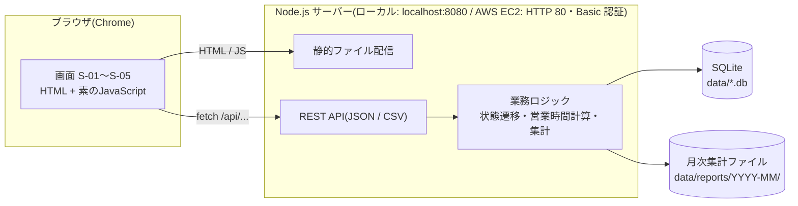
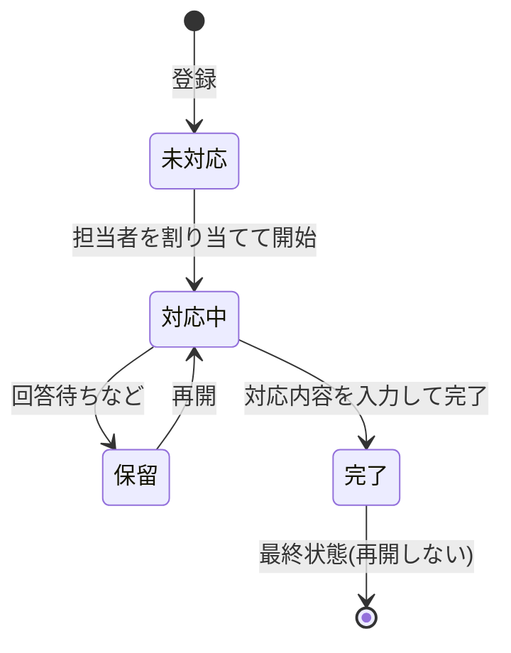
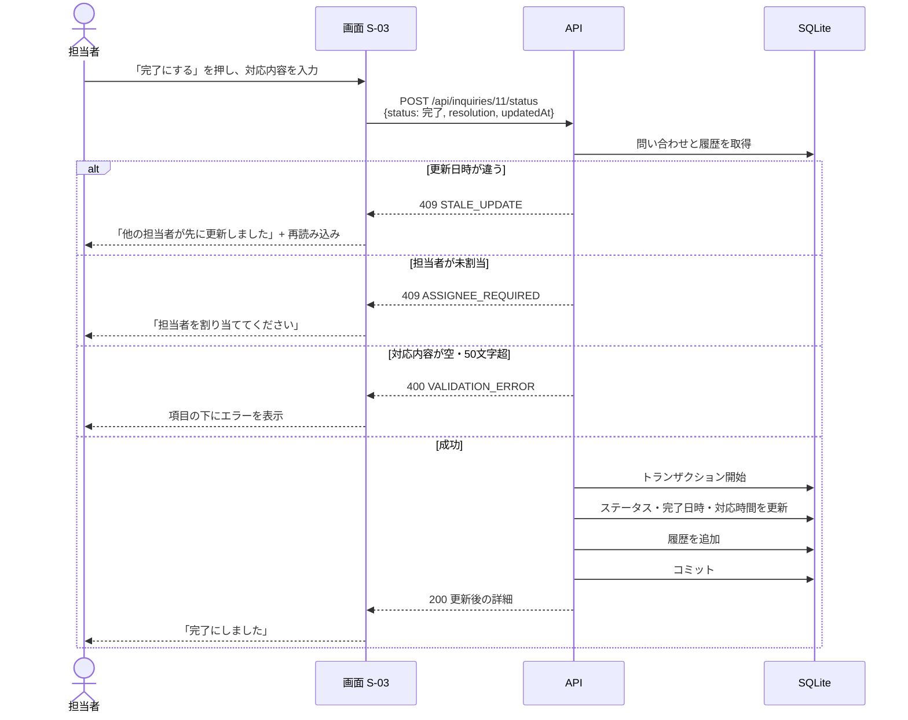
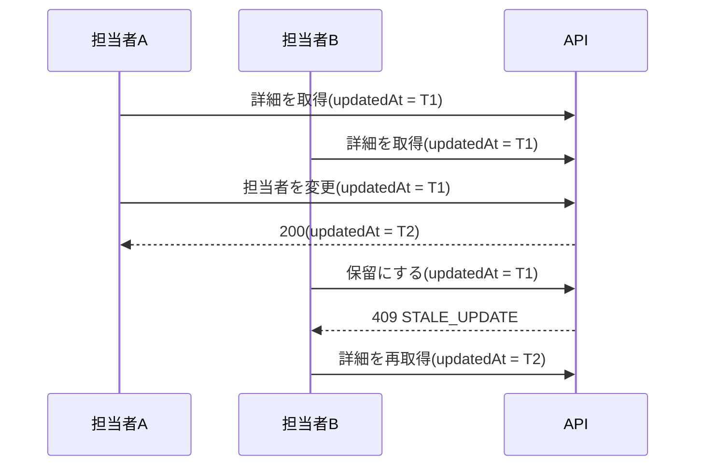
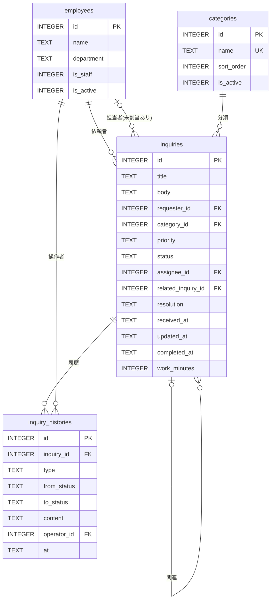

# API設計・DB定義

要件定義書 [requirements.md](requirements.md) と画面設計書 [screen-design.md](screen-design.md) に基づく。**この文書を仕様の正**とする。説明用に図と表をまとめたHTML([mockups/api-overview.html](mockups/api-overview.html))もあるが、内容に差異がある場合はこの文書を優先する。

図は Mermaid で書いており、GitHub 上で表示できる。

## 1. 全体像



| 層 | 技術 | 役割 |
|---|---|---|
| 画面 | HTML / 素のJavaScript | 表示と入力。入力検証はサーバー側でも行う |
| API | Node.js 標準の `http`(外部依存なし) | 入力検証、状態遷移の判定、エラー応答 |
| DB | SQLite(`node:sqlite`) | 永続化。SQLはプレースホルダ(`?`)で実行 |
| 稼働環境 | 既定はローカル(`npm start`)。デプロイは AWS EC2 1 台(Amazon Linux 2023・systemd) | 外部公開は、認証(`APP_PASSWORD`)が必須。手順は [aws-deployment.md](aws-deployment.md) |

## 2. 画面とAPIの対応

| 画面 | 操作 | 呼び出すAPI |
|---|---|---|
| 共通 | 担当者の選択肢を表示 | `GET /api/employees?staff=1&active=1` |
| S-01 一覧 | 一覧表示・絞り込み・並び替え | `GET /api/inquiries`、`GET /api/categories`、`GET /api/employees` |
| S-01 一覧 | CSV出力 | `GET /api/inquiries/export.csv` |
| S-02 登録 | 登録 | `POST /api/inquiries` |
| S-03 詳細 | 表示 | `GET /api/inquiries/{id}` |
| S-03 詳細 | ステータス変更・完了 | `POST /api/inquiries/{id}/status` |
| S-03 詳細 | 担当者割当 | `POST /api/inquiries/{id}/assignee` |
| S-03 詳細 | 編集 | `PATCH /api/inquiries/{id}` |
| S-03 詳細 | コメント追加 | `POST /api/inquiries/{id}/comments` |
| S-04 集計 | 表とグラフの表示 | `GET /api/reports/summary` |
| S-04 集計 | CSV出力 | `GET /api/reports/export.csv` |
| S-04 集計 | 月次保存・保存済み一覧 | `POST /api/reports/monthly`、`GET /api/reports/monthly` |
| S-05 マスタ | 一覧・追加・編集・無効化 | `GET/POST /api/employees`、`PATCH /api/employees/{id}`、`GET/POST /api/categories`、`PATCH /api/categories/{id}` |

## 3. 共通仕様

| 項目 | 内容 |
|---|---|
| 形式 | リクエスト・レスポンスとも JSON(UTF-8)。CSV出力のみ `text/csv`(UTF-8、BOM付き) |
| ベースパス | `/api` |
| 操作者 | 変更系(POST・PATCH)は、ヘッダー `X-Operator-Id` に「操作する担当者」の社員IDを指定する。有効な担当者でなければ 400 |
| 日時 | `YYYY-MM-DD HH:mm:ss.SSS`(日本時間のローカル時刻、文字列) |
| 同時更新 | 問い合わせの更新系(ステータス変更・担当者変更・編集)は、取得時の `updatedAt` を送る。現在の値と違う場合は 409 `STALE_UPDATE`。コメントの追加は `updated_at` を更新せず、競合の対象外とする |
| 文字数 | 自由入力は50文字以内(前後の空白を除いて数える) |
| トランザクション | 問い合わせの更新と履歴の追加は、1トランザクションで行う |
| ポート・DB | 環境変数 `PORT`(既定 8080)、`DB_PATH`(既定 `data/inquiry.db`)で上書きできる |
| 公開・認証 | 環境変数 `HOST`(既定 `127.0.0.1`)、`APP_PASSWORD`(設定すると、全ての画面・API に Basic 認証。`HOST` が localhost 以外のときは必須)、`APP_USER`(既定 `admin`)、`ALLOWED_HOSTS`(localhost 以外で許可する Host 名。`*` で全て)。認証のエラーは、401 とヘッダー `WWW-Authenticate: Basic` を返す |
| ヘルスチェック | `GET /healthz`(認証なし)は、`{"status":"ok"}` を返す。データには触れない |

### ステータスコード

| コード | 意味 | 使う場面 |
|---|---|---|
| 200 | 成功 | 取得・更新・集計 |
| 201 | 作成 | 問い合わせ・社員・カテゴリの登録、月次集計の保存 |
| 400 | 入力不正 | 必須漏れ、50文字超、選択肢外、`X-Operator-Id` が無効 |
| 404 | 存在しない | 存在しないID、存在しないパス |
| 409 | 競合・状態の不整合 | 同時更新、不正なステータス遷移、担当者が未割当、完了済みの更新、無効化の拒否 |
| 500 | 想定外のエラー | 内部エラー(内部情報は返さない) |

### エラー応答

```json
{
  "error": {
    "code": "VALIDATION_ERROR",
    "message": "入力内容を確認してください",
    "fields": [{ "field": "title", "message": "件名は50文字以内で入力してください" }]
  }
}
```

| code | HTTP | 画面での表示(画面設計書 2.3) |
|---|---|---|
| `VALIDATION_ERROR` | 400 | 該当項目の下に、`fields[].message` を表示 |
| `OPERATOR_REQUIRED` | 400 | 操作する担当者を選択してください |
| `NOT_FOUND` | 404 | 問い合わせが見つかりません |
| `STALE_UPDATE` | 409 | 他の担当者が先に更新しました。最新の内容を読み込み直してください |
| `INVALID_TRANSITION` | 409 | 現在のステータスからは変更できません |
| `ASSIGNEE_REQUIRED` | 409 | 担当者を割り当ててください |
| `COMPLETED_LOCKED` | 409 | 完了済みのため編集できません |
| `HAS_OPEN_INQUIRIES` | 409 | 未完了の問い合わせの担当者になっているため、無効にできません(担当者区分の変更では「担当者区分を変更できません」) |
| `DUPLICATE_NAME` | 409 | 同じ名称のカテゴリがあります |
| `INTERNAL_ERROR` | 500 | 処理に失敗しました。時間をおいて、もう一度お試しください |

## 4. エンドポイント一覧

| 区分 | メソッド | パス | 機能 | 機能ID | 成功時 |
|---|---|---|---|---|---|
| 問い合わせ | GET | `/api/inquiries` | 一覧(絞り込み・並び替え・ページング) | F-02 | 200 |
| | GET | `/api/inquiries/export.csv` | 一覧のCSV出力(同じ条件、全件) | F-10 | 200 |
| | POST | `/api/inquiries` | 登録 | F-01 | 201 |
| | GET | `/api/inquiries/{id}` | 詳細と対応履歴 | F-03 | 200 |
| | PATCH | `/api/inquiries/{id}` | 編集(件名・内容・カテゴリ・優先度) | F-07 | 200 |
| | POST | `/api/inquiries/{id}/status` | ステータス変更(完了時は対応内容) | F-04 | 200 |
| | POST | `/api/inquiries/{id}/assignee` | 担当者の割当・変更 | F-05 | 200 |
| | POST | `/api/inquiries/{id}/comments` | コメントの追加 | F-06 | 201 |
| マスタ | GET | `/api/employees` | 社員の一覧 | F-08 | 200 |
| | POST | `/api/employees` | 社員の追加 | F-08 | 201 |
| | PATCH | `/api/employees/{id}` | 社員の編集・有効/無効 | F-08 | 200 |
| | GET | `/api/categories` | カテゴリの一覧 | F-09 | 200 |
| | POST | `/api/categories` | カテゴリの追加 | F-09 | 201 |
| | PATCH | `/api/categories/{id}` | カテゴリの編集・有効/無効 | F-09 | 200 |
| 集計 | GET | `/api/reports/summary` | A-01〜A-06 の集計 | A-01〜A-06 | 200 |
| | GET | `/api/reports/export.csv` | 集計表のCSV出力 | F-12 | 200 |
| | POST | `/api/reports/monthly` | 月次集計の保存 | F-13 | 201 |
| | GET | `/api/reports/monthly` | 保存済み月の一覧 | F-13 | 200 |
| | GET | `/api/reports/monthly/{month}/{file}` | 保存済みファイルのダウンロード | F-13 | 200 |

F-11(サンプルデータ投入)はAPIを持たず、`npm run seed`(npm スクリプト)で実行する。社員または問い合わせが既にあるDBには何もしない。カテゴリの初期値(5種)は、アプリの起動時に、カテゴリが1件も無い場合だけ作成する。

## 5. 主要APIの詳細

問い合わせの変更系(5.4〜5.7)は、次の順に判定し、最初に該当したエラーを返す。

| 順 | 判定 | 応答 |
|---|---|---|
| 1 | 操作者(`X-Operator-Id`)が有効な担当者か | 400 `OPERATOR_REQUIRED` |
| 2 | 対象の問い合わせが存在するか | 404 `NOT_FOUND` |
| 3 | 入力の検証(必須・50文字・選択肢) | 400 `VALIDATION_ERROR` |
| 4 | 更新日時が現在の値と一致するか | 409 `STALE_UPDATE` |
| 5 | 状態・業務ルール(遷移・担当者・完了済み) | 409 |

したがって、入力の不備と更新日時の不一致が同時にあるときは、入力の不備(400)を先に返す。

### 5.1 `GET /api/inquiries`(一覧)

| クエリ | 型 | 内容 |
|---|---|---|
| `status` | 文字列 | 未対応 / 対応中 / 保留 / 完了(省略は全件) |
| `categoryId` | 整数 | カテゴリで絞り込み |
| `assigneeId` | 整数 または `none` | 担当者。`none` は未割当 |
| `dept` | 文字列 | 依頼者の部署 |
| `q` | 文字列 | 件名・内容のキーワード(`%` `_` は文字として扱う) |
| `sort` | `received` / `priority` | 並び替えの項目(既定 `received`) |
| `dir` | `asc` / `desc` | 既定 `desc` |
| `page` | 整数 | 1から。1ページ20件 |

レスポンス(200):

```json
{
  "items": [
    { "id": 11, "title": "VPNに接続できない", "category": { "id": 1, "name": "PC・ネットワーク" },
      "requester": { "id": 8, "name": "小林 優子", "dept": "開発" },
      "priority": "高", "status": "対応中",
      "assignee": { "id": 1, "name": "山田 太郎" }, "receivedAt": "2026-09-24 10:20:00.000" }
  ],
  "total": 15, "page": 1, "pageSize": 20
}
```

### 5.2 `POST /api/inquiries`(登録)

| 項目 | 型 | 必須 | 制約 |
|---|---|---|---|
| `title` | 文字列 | 必須 | 1〜50文字 |
| `body` | 文字列 | 必須 | 1〜50文字 |
| `requesterId` | 整数 | 必須 | 有効な社員 |
| `categoryId` | 整数 | 必須 | 有効なカテゴリ |
| `priority` | 文字列 | 必須 | 高 / 中 / 低 |
| `relatedInquiryId` | 整数 | 任意 | 存在する問い合わせ |

- 201 で、作成した問い合わせ(詳細と同じ形)を返す。ステータスは「未対応」、担当者は未割当、受付日時はサーバーが設定する。
- 400: 入力不正(`fields` に項目ごとのメッセージ)。

### 5.3 `GET /api/inquiries/{id}`(詳細)

レスポンス(200)は、5.1 の項目に加えて `body`、`resolution`(完了後のみ)、`completedAt`、`workMinutes`、`relatedInquiry`、`updatedAt`、`histories`(古い順)を含む。404: 存在しないID。

### 5.4 `POST /api/inquiries/{id}/status`(ステータス変更)

| 項目 | 型 | 必須 | 制約 |
|---|---|---|---|
| `status` | 文字列 | 必須 | 現在のステータスから遷移できる値 |
| `resolution` | 文字列 | 完了時のみ必須 | 1〜50文字 |
| `updatedAt` | 文字列 | 必須 | 取得時の更新日時 |

| 条件 | 応答 |
|---|---|
| `updatedAt` が現在の値と違う | 409 `STALE_UPDATE` |
| 遷移できない(例: 未対応 → 完了、完了 → 対応中) | 409 `INVALID_TRANSITION` |
| 担当者が未割当で、対応中・保留・完了にする | 409 `ASSIGNEE_REQUIRED` |
| 完了時に `resolution` が空、または50文字超 | 400 `VALIDATION_ERROR` |
| 成功 | 200(更新後の詳細)。履歴にステータス変更を追加。完了時は `completedAt` と `workMinutes` を設定 |

### 5.5 `POST /api/inquiries/{id}/assignee`(担当者割当)

| 項目 | 型 | 必須 | 制約 |
|---|---|---|---|
| `assigneeId` | 整数 | 必須 | 有効な「担当者」区分の社員 |
| `updatedAt` | 文字列 | 必須 | 取得時の更新日時 |

409: `STALE_UPDATE`、完了済みは `COMPLETED_LOCKED`。履歴に担当者変更を追加する。

### 5.6 `PATCH /api/inquiries/{id}`(編集)

`title`、`body`、`categoryId`、`priority`(指定した項目だけ更新)と `updatedAt`(必須)。検証は 5.2 と同じ。409: `STALE_UPDATE`、完了済みは `COMPLETED_LOCKED`。履歴に編集を追加する。

### 5.7 `POST /api/inquiries/{id}/comments`(コメント)

`text`(必須、1〜50文字)。完了済みでも追加できる。コメントは競合の対象外(`updatedAt` は不要)で、問い合わせの `updated_at` も更新しない(他の担当者のコメントのせいで、ステータス変更が 409 にならないようにするため)。履歴にだけ追加する。

### 5.8 マスタ

| API | 主な入力 | 主なエラー |
|---|---|---|
| `POST /api/employees` | `name`、`department`(各1〜50文字)、`isStaff` | 400 |
| `PATCH /api/employees/{id}` | `name`、`department`、`isStaff`、`isActive` | 400、404、409 `HAS_OPEN_INQUIRIES`(未完了の問い合わせの担当者になっている社員を、無効にする、または担当者区分を「一般」にしようとした場合) |
| `POST /api/categories` | `name`(1〜50文字、重複不可)、`sortOrder`(0以上の整数) | 400、409 `DUPLICATE_NAME`(無効なカテゴリとの重複を含む) |
| `PATCH /api/categories/{id}` | `name`、`sortOrder`、`isActive` | 400、404、409 `DUPLICATE_NAME` |

- 一覧は `{ "items": [...] }` で返す。社員は `staff`・`active`(`1` / `0`)、カテゴリは `active` で絞り込める。社員は ID 順、カテゴリは表示順(同じなら ID 順)。
- 社員・カテゴリの項目は `id`、`name`、`department`・`isStaff`・`isActive`(社員)/ `sortOrder`・`isActive`(カテゴリ)。
- 変更系(POST・PATCH)は、操作者(`X-Operator-Id`)が必須。ただし初期セットアップのため、有効な「担当者」区分の社員が1人もいない間だけ、`POST /api/employees` は操作者なしで受け付ける(最初の担当者を登録できるようにする)。
- 削除APIはない(無効化で扱う)。無効なカテゴリは新規の問い合わせで選べないが、過去の問い合わせには表示される。使用中のカテゴリも無効にできる。

### 5.9 `GET /api/reports/summary?from=YYYY-MM-DD&to=YYYY-MM-DD`

```json
{
  "period": { "from": "2026-07-01", "to": "2026-10-12" },
  "a01": [{ "category": "PC・ネットワーク", "count": 5 }],
  "a02": [{ "dept": "開発", "count": 4 }],
  "a03": [{ "category": "PC・ネットワーク", "doneCount": 4, "avgMinutes": 199 }],
  "a04": [{ "assignee": "山田 太郎", "done": 4, "open": 1 }],
  "a05": [{ "month": "2026-07", "count": 3 }],
  "a06": [{ "status": "未対応", "count": 2 }]
}
```

- 対象は、受付日時が期間内(`from` の 0:00 〜 `to` の 23:59:59.999)の問い合わせ。
- `avgMinutes` は分単位で切り捨てる。完了0件は `null`(画面は「-」、CSVは空欄)。
- 0件の項目も返す: 有効なカテゴリ、有効な社員がいる部署、有効な担当者、期間内のすべての月、4つのステータス。無効なカテゴリ・期間内に担当した無効な社員は、件数があるときだけ返す。
- `a04` は、担当者が未割当の問い合わせがあるとき、末尾に `{ "assignee": "未割当", "done": 0, "open": 件数 }` を返す。
- `a02` は件数の多い順(同数は部署名順)。`a01`・`a03` は表示順。
- `from` が `to` より後、日付形式が不正、または期間が20年を超える(`from` の20年後の日付より後に `to` がある)場合は 400。20年を超える場合のエラーは、項目 `to`(「集計期間は20年以内にしてください」)。CSV出力(5.10)にも同じ上限がある。

### 5.10 CSV出力

| API | クエリ | 内容 |
|---|---|---|
| `GET /api/inquiries/export.csv` | 5.1 と同じ絞り込み・並び順(`page` は無視) | 条件に合う全件 |
| `GET /api/reports/export.csv` | `type`(`a01`〜`a06`)、`from`、`to` | 指定した集計表 |

- UTF-8(BOM付き)、改行は CRLF。`Content-Disposition` でファイル名を指定する(一覧: `inquiries-YYYYMMDD.csv`、集計: `report-a01-<from>_<to>.csv`)。
- 先頭が `=` `+` `-` `@`(およびタブ・CR)のセルは、先頭に `'` を付ける。値にカンマ・改行・`"` が含まれる場合は引用符で囲み、`"` は二重にする。
- 一覧の列: ID、件名、内容、カテゴリ、依頼者、部署、優先度、ステータス、担当者、受付日時、完了日時、対応内容、対応時間(`H:mm`。未完了は空欄)。
- `type` が `a01`〜`a06` 以外、または期間が不正な場合は 400。

### 5.11 月次集計の保存(F-13)

| API | 入力 | 動作 |
|---|---|---|
| `POST /api/reports/monthly` | `month`(`YYYY-MM`)。操作者が必須 | その月の1日〜末日で A-01〜A-06 を集計し、`data/reports/YYYY-MM/` にCSV(6)とSVG(6)を保存する。既存の月は上書きする。201 で `{ "month", "savedAt", "files", "overwritten" }` を返す |
| `GET /api/reports/monthly` | なし | `{ "items": [{ "month": "2026-09", "savedAt": "…", "files": ["a01.csv", "a01.svg", …] }] }`(月の昇順。保存が無ければ空) |
| `GET /api/reports/monthly/{month}/{file}` | パス | 保存済みファイルを返す。`month` は `YYYY-MM`、`file` は `a01〜a06` の `.csv` / `.svg` に限る(それ以外は 404。パスの `..` は受け付けない) |

SVGは、画面と同じ描画ロジック(`public/js/charts.js`)をサーバー側で共有して生成する(外部ライブラリなし)。集計表の定義(見出し・行・グラフの種類)も `public/js/report-tables.js` を、画面・CSV・月次保存で共有する。

- 保存は、一時ディレクトリに全ファイルを書いてから入れ替える(途中で失敗しても、前回の保存を壊さない)。保存先は DB ファイルと同じディレクトリの `reports/`(既定は `data/reports/`)。
- 各月のディレクトリには、ファイルの一覧と保存日時を持つ `meta.json` も置く(ダウンロードの対象外)。
- ダウンロード時の `Content-Disposition` のファイル名は `<month>-<file>`(例: `2026-09-a01.csv`)。

## 6. 図

### 6.1 ステータス遷移



### 6.2 完了までの流れ(シーケンス)



### 6.3 同時更新の検出(楽観ロック)



### 6.4 対応時間の計算(営業時間・保留除外)

営業時間は平日 9:00〜18:00。例として、金曜 16:30 に受付、月曜 9:00〜13:00 は保留、火曜 10:00 に完了した場合。

| 日 | 時間帯 | 営業時間内の経過 | 保留 | 対応時間に数える |
|---|---|---|---|---|
| 金 2026/10/09 | 16:30〜18:00 | 1:30 | なし | 1:30 |
| 土・日 | — | 数えない | — | 0:00 |
| 月 2026/10/12 | 9:00〜18:00 | 9:00 | 9:00〜13:00(4:00) | 5:00 |
| 火 2026/10/13 | 9:00〜10:00 | 1:00 | なし | 1:00 |
| **合計** | | | | **7:30(450分)** |

計算は、完了時にサーバーが履歴(ステータス変更の日時)から求め、`inquiries.work_minutes` に保存する。

## 7. DB定義(SQLite)

### 7.1 ER図



### 7.2 テーブル定義

文字数の制約(「1〜50文字」)は、`CHECK(length(trim(列)) BETWEEN 1 AND 50)` で表す。SQLite の `length()` は TEXT の文字数を数える。APIは、保存する前に前後の空白を取り除く。`is_staff`・`is_active` は `CHECK(列 IN (0, 1))`。

#### employees(社員)

| 列 | 型 | 制約 | 内容 |
|---|---|---|---|
| id | INTEGER | PK、自動採番 | 社員ID |
| name | TEXT | NOT NULL、1〜50文字 | 氏名 |
| department | TEXT | NOT NULL、1〜50文字 | 部署 |
| is_staff | INTEGER | NOT NULL、0/1、既定0 | 担当者区分(1=担当者) |
| is_active | INTEGER | NOT NULL、0/1、既定1 | 有効フラグ |

#### categories(カテゴリ)

| 列 | 型 | 制約 | 内容 |
|---|---|---|---|
| id | INTEGER | PK、自動採番 | カテゴリID |
| name | TEXT | NOT NULL、UNIQUE、1〜50文字 | 名称 |
| sort_order | INTEGER | NOT NULL | 表示順 |
| is_active | INTEGER | NOT NULL、0/1、既定1 | 有効フラグ |

#### inquiries(問い合わせ)

| 列 | 型 | 制約 | 内容 |
|---|---|---|---|
| id | INTEGER | PK、自動採番 | 問い合わせID |
| title | TEXT | NOT NULL、1〜50文字 | 件名 |
| body | TEXT | NOT NULL、1〜50文字 | 内容 |
| requester_id | INTEGER | NOT NULL、FK → employees | 依頼者 |
| category_id | INTEGER | NOT NULL、FK → categories | カテゴリ |
| priority | TEXT | NOT NULL、CHECK(高/中/低) | 優先度 |
| status | TEXT | NOT NULL、CHECK(未対応/対応中/保留/完了) | ステータス |
| assignee_id | INTEGER | FK → employees、NULL可 | 担当者 |
| related_inquiry_id | INTEGER | FK → inquiries、NULL可 | 関連する問い合わせ |
| resolution | TEXT | NULL可、完了時は必須 | 対応内容 |
| received_at | TEXT | NOT NULL | 受付日時 |
| updated_at | TEXT | NOT NULL | 更新日時(楽観ロックに使う) |
| completed_at | TEXT | NULL可 | 完了日時 |
| work_minutes | INTEGER | NULL可 | 対応時間(分)。完了時に計算して保存する |

追加の整合性(CHECK):
- 担当者は、ステータスが「未対応」以外では必須: `CHECK(status = '未対応' OR assignee_id IS NOT NULL)`
- 完了と、完了関連の列は一対一に対応する(完了以外では空、完了では必須):
  `CHECK((status = '完了') = (completed_at IS NOT NULL AND resolution IS NOT NULL AND work_minutes IS NOT NULL))`、かつ `CHECK(status = '完了' OR (completed_at IS NULL AND resolution IS NULL AND work_minutes IS NULL))`
- 関連する問い合わせは自分自身を指せない: `CHECK(related_inquiry_id IS NULL OR related_inquiry_id <> id)`
- 対応時間は0以上: `CHECK(work_minutes IS NULL OR work_minutes >= 0)`
- 日時列(`received_at`、`updated_at`、`completed_at`)の形式: `CHECK(received_at GLOB '[0-9][0-9][0-9][0-9]-[0-1][0-9]-[0-3][0-9] [0-2][0-9]:[0-5][0-9]:[0-5][0-9].[0-9][0-9][0-9]')`(他の日時列も同様。`completed_at` は NULL を許す)

`assignee_id` が「担当者区分(`is_staff = 1`)の有効な社員」であることは、外部キーでは保証できないため、APIで検証する(5.5)。担当者区分を「一般」にする、または無効にするときは、未完了の問い合わせの担当者になっていないかをAPIで確認する(5.8)。

#### inquiry_histories(対応履歴)

| 列 | 型 | 制約 | 内容 |
|---|---|---|---|
| id | INTEGER | PK、自動採番 | 履歴ID |
| inquiry_id | INTEGER | NOT NULL、FK → inquiries | 問い合わせ |
| type | TEXT | NOT NULL、CHECK | 種別: `registered`(登録)/ `status`(ステータス変更)/ `assignee`(担当者変更)/ `comment`(コメント)/ `edit`(編集) |
| from_status | TEXT | NULL可。値は4つのステータスのいずれか | 変更前のステータス(`type` が `status` のとき必須) |
| to_status | TEXT | NULL可。値は4つのステータスのいずれか | 変更後のステータス(`type` が `status` のとき必須) |
| content | TEXT | NULL可 | コメントの内容、変更内容の説明。`type` が `comment` のときは必須(1〜50文字) |
| operator_id | INTEGER | NOT NULL、FK → employees | 操作者 |
| at | TEXT | NOT NULL | 日時 |

### 7.3 索引

| 索引 | 目的 |
|---|---|
| `inquiries(status)` | 一覧のステータス絞り込み、A-06 |
| `inquiries(received_at, id)` | 並び順(受付日時、同時刻はIDで順序を固定)、期間指定、A-05 |
| `inquiries(assignee_id, status)` | 担当者別の集計、無効化の可否判定 |
| `inquiries(category_id)` | A-01、A-03 |
| `inquiry_histories(inquiry_id, at)` | 詳細の履歴表示、保留期間の算出 |

### 7.4 運用の規則
- 外部キー制約を有効にする(`PRAGMA foreign_keys = ON`)。
- 物理削除はしない。社員・カテゴリは `is_active` で無効化する。
- DBファイル(`*.db`)と `data/` は Git に含めない。初回起動時にテーブルを自動作成する。
- スキーマの版は `PRAGMA user_version` で持つ(初版は 1)。起動時に版を確認し、未作成なら作成する。
- 書き込みが重なったときに待てるよう、`PRAGMA busy_timeout`(例: 3000ミリ秒)を設定する。
- 一覧の並びは「受付日時 → ID」の順(同じ時刻でも順序が変わらない)。
- コメントの追加は、履歴だけを追加し、`inquiries.updated_at` は更新しない。ステータス変更・担当者変更・編集では更新する。
- 日時はアプリが `YYYY-MM-DD HH:mm:ss.SSS`(日本時間)で生成して保存する。DBの `CURRENT_TIMESTAMP`(UTC)は使わない。

## 8. 要件との対応

| 要件 | API | テーブル |
|---|---|---|
| F-01 登録 | `POST /api/inquiries` | inquiries、inquiry_histories |
| F-02 一覧 | `GET /api/inquiries` | inquiries、employees、categories |
| F-03 詳細 | `GET /api/inquiries/{id}` | inquiries、inquiry_histories |
| F-04 ステータス変更 | `POST /api/inquiries/{id}/status` | inquiries、inquiry_histories |
| F-05 担当者割当 | `POST /api/inquiries/{id}/assignee` | inquiries、inquiry_histories |
| F-06 対応履歴 | 上記の更新系と `POST /api/inquiries/{id}/comments` | inquiry_histories |
| F-07 編集 | `PATCH /api/inquiries/{id}` | inquiries、inquiry_histories |
| F-08 社員マスタ | `/api/employees` | employees |
| F-09 カテゴリマスタ | `/api/categories` | categories |
| F-10 一覧CSV | `GET /api/inquiries/export.csv` | inquiries |
| F-11 サンプルデータ | `npm run seed`(APIなし) | 全テーブル |
| F-12 集計CSV | `GET /api/reports/export.csv` | inquiries |
| F-13 月次保存 | `/api/reports/monthly` | inquiries(+ ファイル) |
| A-01〜A-06 | `GET /api/reports/summary` | inquiries、employees、categories |
