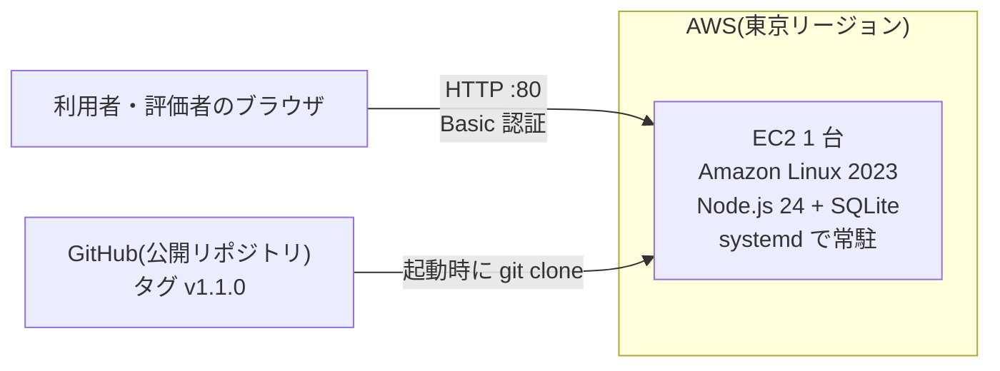

# AWS へのデプロイ手順(EC2 を 1 台)

課題の提出必須要件「AWS へデプロイし、URL を提出する」のための手順。判断の理由は [deployment-decision.md](deployment-decision.md)。

## 全体像



| 項目 | 内容 |
|---|---|
| 使う AWS のサービス | **EC2(1 台)**と、そのセキュリティグループ・ディスク(EBS)だけ |
| 使わないもの | ロードバランサー・RDS・NAT ゲートウェイ・Elastic IP・Route 53(いずれも、追加の費用が発生しやすい) |
| データ | SQLite のファイルを、EC2 のディスク(`/var/lib/inquiry-management`)に置く。**サンプルデータだけ**。実データは入れない |
| 認証 | Basic 認証(ユーザー名とパスワード)。パスワードが無ければ、外部向けには起動しない |
| 通信 | HTTP(暗号化なし)。サンプルデータのみのため、課題の範囲では許容する(下の「制限」) |

## 費用(最小限にするために)

> 料金・無料枠の条件は変わります。**実際のアカウントで、AWS の画面の表示を確認してください**。以下は、目安です。

| 項目 | 目安 |
|---|---|
| EC2(t3.micro・東京) | 1 時間あたり、約 0.01 ドル台(無料利用枠・クレジットの対象なら、その範囲内) |
| パブリック IPv4 アドレス | 1 時間あたり、約 0.005 ドル(無料利用枠の対象の場合あり) |
| ディスク(8 GiB) | 1 か月あたり、1 ドル未満 |
| **数日間の利用** | **1 ドル前後**(無料利用枠・クレジットがあれば、さらに少ない) |
| 放置した場合 | 1 か月あたり、十数ドルになりうる。**評価の後は、必ず削除する**(下の「後始末」) |

## 手順

### 0. 事前(開発側で実施済みであること)

- 公開リポジトリ(`inquiry-management`)に、タグ `v1.1.0` がある(`deploy/` フォルダを含む)

### 1. 請求のアラートを設定する(先に行う)

1. AWS マネジメントコンソールの右上で、リージョンを **アジアパシフィック(東京)ap-northeast-1** にする(請求の画面は、リージョンに依らない)
2. 「**Billing and Cost Management**」→「**Budgets**」→「予算を作成」
3. 「コスト予算」(月次)・金額 **5 ドル**・通知先のメールアドレスを入力して、作成する

### 2. EC2 のインスタンスを起動する

コンソールの「**EC2**」→「**インスタンスを起動**」で、次のとおりに設定する。記載のない項目は、既定のままにする。

| 項目 | 設定 |
|---|---|
| 名前 | `inquiry-management` |
| アプリケーションおよび OS イメージ(AMI) | **Amazon Linux 2023**(「無料利用枠の対象」の表示があるもの) |
| インスタンスタイプ | **t3.micro**(「無料利用枠の対象」の表示があるものを選ぶ。なければ t2.micro) |
| キーペア | 「**キーペアなしで続行**」(SSH でログインしない) |
| ネットワーク設定 → パブリック IP の自動割り当て | **有効** |
| ネットワーク設定 → ファイアウォール(セキュリティグループ) | 「セキュリティグループを作成」。「**HTTP(80)を許可**」(ソース: 0.0.0.0/0)。**「SSH トラフィックを許可」のチェックは外す** |
| ストレージ | 8 GiB(gp3)のまま |
| 高度な詳細 → **ユーザーデータ** | 下の「ユーザーデータ」を貼り付ける |

#### ユーザーデータ

`ここを…` の部分だけを、自分で決めたパスワードに書き換えて、貼り付ける。

- 12 文字以上
- 使える文字は、**英数字と `.` `_` `@` `+` `=` `,` `/` `-` だけ**(空白・引用符・記号は使わない)
- 評価者に伝えるパスワードになる。**他のサービスと同じパスワードは使わない**

```bash
#!/bin/bash
set -euo pipefail
export APP_PASSWORD='ここを12文字以上のパスワードに書き換える'
export REF='v1.1.0'
dnf install -y git
git clone --depth 1 --branch "$REF" https://github.com/chengdanei48-beep/inquiry-management.git /opt/inquiry-management
bash /opt/inquiry-management/deploy/setup-ec2.sh
```

「インスタンスを起動」を押す。**起動の後、セットアップが終わるまで、2〜4 分かかる。**

### 3. 動作を確認する

1. EC2 の「インスタンス」で、`inquiry-management` を選び、「**パブリック IPv4 アドレス**」をコピーする
2. ブラウザで `http://<パブリック IPv4 アドレス>/` を開く
   - 「https」ではなく、**http** で開く。ブラウザが自動で https にする場合は、アドレスを手で入力して、http を指定する
3. ユーザー名 `admin` と、設定したパスワードを入力する
4. 次を確認する

| 確認 | 期待する結果 |
|---|---|
| `http://<IP>/healthz` | `{"status":"ok"}` が表示される(認証なし) |
| `http://<IP>/` | 認証を求められ、入力すると、問い合わせの一覧が表示される |
| 一覧・登録・集計 | サンプルデータ(社員 10 名・問い合わせ 15 件)が表示され、操作できる |
| 誤ったパスワード | 画面が表示されない(401) |

### 4. うまくいかないとき

| 症状 | 確認すること |
|---|---|
| 画面が開かない(タイムアウト) | 起動して 4 分以上たったか。セキュリティグループに、HTTP(80)のルールがあるか。パブリック IP のコピーが正しいか。**https でなく http か** |
| 「接続できません」 | セットアップの失敗の可能性。EC2 の「アクション」→「モニタリングとトラブルシューティング」→「**システムログを取得**」で、末尾の `[setup]` の行と、エラーを確認する |
| ログインできない | パスワードの書き換えのとき、引用符 `'` を消していないか。ユーザー名は `admin` |
| セットアップが「APP_PASSWORD…」で止まる | パスワードの長さ(12 文字以上)と、使える文字を確認する |

システムログに原因が見当たらないときは、その表示(パスワードの部分を除く)を、開発側に伝える。

### 5. 提出するもの

| 項目 | 内容 |
|---|---|
| アプリの URL | `http://<パブリック IPv4 アドレス>/` |
| ユーザー名・パスワード | `admin` と、設定したパスワード(提出先の指定の方法で伝える) |
| ソースコード | https://github.com/chengdanei48-beep/inquiry-management |

> インスタンスを「停止」して「開始」すると、**パブリック IP アドレスが変わる**。URL を提出した後は、評価が終わるまで、停止しない。

### 6. 後始末(評価の後に、必ず行う)

1. EC2 の「インスタンス」で、`inquiry-management` を選び、「**インスタンスの状態**」→「**インスタンスを終了(削除)**」
2. 「ボリューム」に、残っているものがないことを確認する(終了すれば、通常は、自動で削除される)
3. (任意)セキュリティグループを削除する(費用はかからない)
4. 翌日以降に、「Billing」の画面で、請求額が増えていないことを確認する

## 更新するとき(コードを変更したとき)

- いちばん簡単なのは、**インスタンスを終了して、手順 2 をやり直す**(`REF` に、新しいタグを指定する)
- 同じインスタンスで更新する場合は、`REF` を変えて、`deploy/setup-ec2.sh` を再実行する(データは消えない。パスワードを変えたいときも、同じ)

## 制限(課題の範囲で、許容していること)

| 項目 | 内容 | 本番で必要な対策 |
|---|---|---|
| 通信が暗号化されない | Basic 認証のパスワードが、通信経路で読み取られうる | HTTPS(ロードバランサー・CloudFront などと、独自ドメイン・証明書) |
| パスワードの試行回数の制限がない | 総当たりの攻撃を受けうる | 試行回数の制限・ログイン画面・ユーザーごとの認証 |
| 1 台構成・バックアップなし | サーバーが壊れると、データは失われる | 自動バックアップ(スナップショット)・RDS など |
| 操作する担当者は「選ぶだけ」 | 認証の後でも、なりすましはできる | ユーザーごとのログイン |
| 実データを入れない | | 個人情報を扱う場合は、上の対策が全て必要 |
