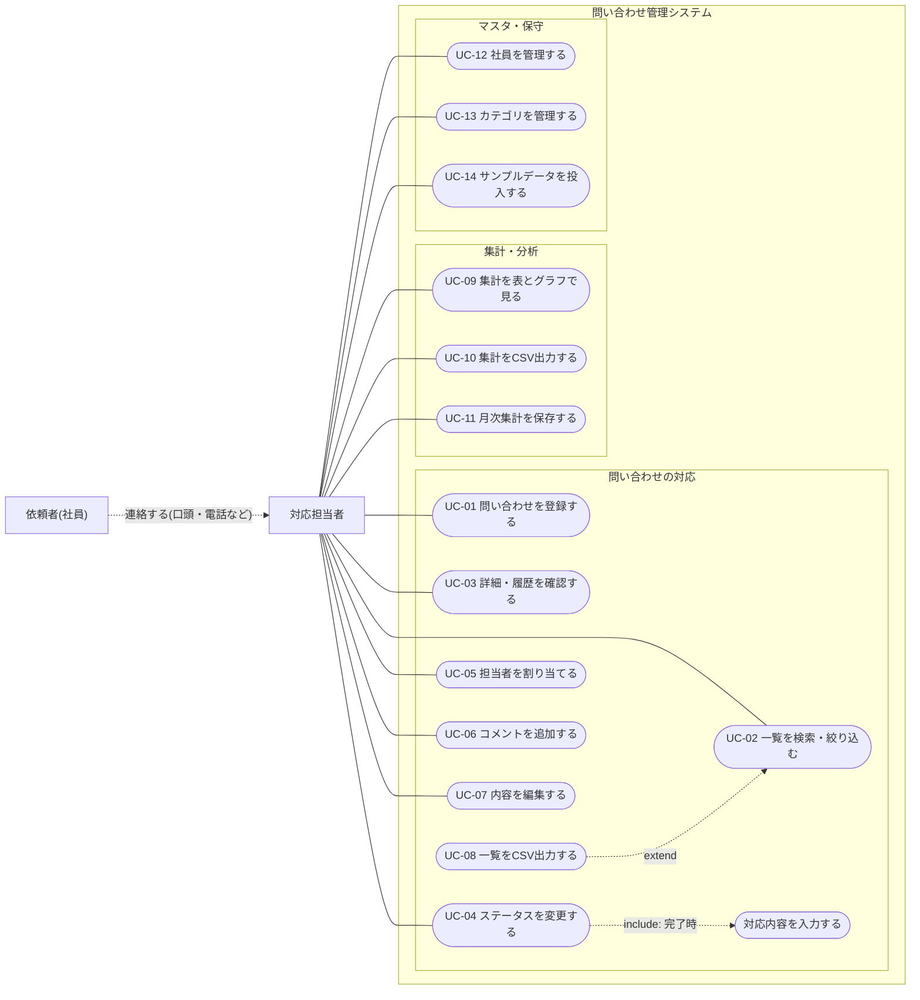

# 要件定義書

## 1. 目的・背景

社内ヘルプデスクに寄せられる問い合わせを一元的に記録・管理し、**対応実績を集計・分析できる**ようにするアプリを作成する。

- 題材の選定理由は [selection-rationale.md](selection-rationale.md) を参照。
- 分野を社内ヘルプデスクとした理由は次のとおり。
  - 依頼者も担当者も社員で完結し、顧客マスタや個人情報の公開範囲といった論点が増えない。
  - カテゴリ(PC不具合、アカウント、備品申請など)とステータスが明確で、集計結果に意味が出る。
  - 「どのカテゴリが多いか」「どこで対応が滞っているか」を、改善の判断材料として説明しやすい。

### 決定事項

| 項目 | 内容 |
|---|---|
| 分野 | 社内ヘルプデスク(社員 → 情報システム部・総務・人事への問い合わせ) |
| 種類 | フォーム入力の単一チャネル(Web画面から手入力で登録し、カテゴリで分類) |
| 用途 | 対応実績の分析・集計を重視 |

## 2. 対象範囲

### スコープ内
- 問い合わせの登録・一覧・詳細表示・検索/絞り込み
- ステータス変更、担当者の割当、対応履歴の記録
- 社員マスタ、カテゴリマスタの管理
- 対応実績の集計・表示(表とグラフ)
- 問い合わせ一覧・集計結果のCSV出力
- 月ごとの集計結果(CSVとグラフ)のファイル保存
- サンプルデータ(初期データ)の投入

### スコープ外
- メール、電話、チャットなど外部チャネルとの連携(受付チャネルはフォーム入力のみ)
- 外部への通知(メール送信、Slack 連携など)
- 依頼者本人が投稿する公開フォーム
- 本格的な認証・権限管理(ログイン画面、パスワード管理)
- クラウド環境・外部サービスの利用
- 祝日・昼休みを考慮した営業時間の計算(将来の拡張として扱う)

## 3. 利用者と役割

| 役割 | 内容 |
|---|---|
| 対応担当者 | ヘルプデスクの担当社員。問い合わせの登録、ステータス変更、対応記録、集計の閲覧を行う |
| 依頼者 | 問い合わせを行った社員。システムの操作者ではなく、社員マスタ上のデータとして登録される |

認証は行わず、画面上で「操作する担当者」を選択する簡易方式とする。履歴にはその担当者名を記録する。選択した担当者はブラウザに保存し、次回の画面表示でも既定値とする(保存できない環境では毎回選択する)。

### 3.1 ユースケース図

「誰が、システムで何をするか」を示す。依頼者はシステムを操作せず、対応担当者に連絡する関係者として表す。



読み方:
- 実線は「アクターがユースケースを実行する」、点線は関係を表す。
- 「ステータスを変更する」は、完了にするときに「対応内容を入力する」を含む(include)。
- 「一覧をCSV出力する」は、「一覧を検索・絞り込む」で指定した条件を引き継いで実行する(extend)。
- 「サンプルデータを投入する」は画面を持たず、npm スクリプトで実行する。

### 3.2 ユースケース記述

| ID | ユースケース | アクター | 概要 | 事前条件 | 主な例外 | 機能ID | 画面 |
|---|---|---|---|---|---|---|---|
| UC-01 | 問い合わせを登録する | 対応担当者 | 依頼者から受けた問い合わせを、件名・内容・依頼者・カテゴリ・優先度で登録する。ステータスは「未対応」 | 操作する担当者を選択済み | 必須漏れ・50文字超、関連IDが存在しない | F-01 | S-02 |
| UC-02 | 一覧を検索・絞り込む | 対応担当者 | ステータス・カテゴリ・担当者・部署・キーワードで絞り込み、並び替える | なし | 該当なし(0件表示) | F-02 | S-01 |
| UC-03 | 詳細・履歴を確認する | 対応担当者 | 問い合わせの内容と、対応履歴を時系列で確認する | 問い合わせが存在する | 存在しないID(404) | F-03 | S-03 |
| UC-04 | ステータスを変更する | 対応担当者 | 未対応→対応中→保留/完了と変更する。完了時は対応内容を入力する | 担当者が割り当て済み。完了でない | 不正な遷移、担当者未割当、同時更新(409)、対応内容の不備 | F-04 | S-03 |
| UC-05 | 担当者を割り当てる | 対応担当者 | 担当者を割り当てる、または変更する | 完了でない | 同時更新(409)、完了済み | F-05 | S-03 |
| UC-06 | コメントを追加する | 対応担当者 | 対応の経過をコメントとして履歴に追加する。完了後も可能 | 操作する担当者を選択済み | 50文字超 | F-06 | S-03 |
| UC-07 | 内容を編集する | 対応担当者 | 件名・内容・カテゴリ・優先度を修正する。修正は履歴に残る | 完了でない | 同時更新(409)、完了済み、入力不備 | F-07 | S-03 |
| UC-08 | 一覧をCSV出力する | 対応担当者 | 現在の絞り込み条件と並び順で、一覧全件をCSVでダウンロードする | なし | 該当なし(ヘッダーのみ) | F-10 | S-01 |
| UC-09 | 集計を表とグラフで見る | 対応担当者 | 期間を指定して、件数・対応時間・推移を表とグラフで確認する(A-01〜A-06) | なし | 期間の不正(開始日 > 終了日)、該当なし | A-01〜A-06 | S-04 |
| UC-10 | 集計をCSV出力する | 対応担当者 | 集計表を、指定した期間でCSVとしてダウンロードする | なし | 期間の不正 | F-12 | S-04 |
| UC-11 | 月次集計を保存する | 対応担当者 | 対象月の集計表(CSV)とグラフ(SVG)を、月ごとのファイルとして保存する。保存済みの月は上書きできる | 操作する担当者を選択済み | 対象月の未指定 | F-13 | S-04 |
| UC-12 | 社員を管理する | 対応担当者 | 社員の追加・編集・無効化を行う。担当者区分を設定する | 操作する担当者を選択済み | 未完了の担当案件がある社員の無効化・区分変更(409)、入力不備 | F-08 | S-05 |
| UC-13 | カテゴリを管理する | 対応担当者 | カテゴリの追加・編集・無効化を行う | 操作する担当者を選択済み | 名称の重複(409)、入力不備 | F-09 | S-05 |
| UC-14 | サンプルデータを投入する | 対応担当者 | 動作確認とグラフ表示のため、社員と問い合わせのサンプルを投入する(npm スクリプト) | DBが空 | 既存データがある場合は何もしない | F-11 | なし |

## 4. 業務フロー

1. 依頼者から連絡を受けた担当者が、問い合わせをフォームから登録する(状態: 未対応)。
2. 担当者を割り当て、対応を開始する(状態: 対応中)。
3. 回答待ちなどで止まる場合は保留にする(状態: 保留)。
4. 解決したら完了にする(状態: 完了)。完了は最終状態で、元には戻せない。完了後に再度の対応が必要な場合は、新規の問い合わせとして登録する。
5. 各操作は対応履歴として残り、蓄積したデータを集計画面で確認する。

### ステータス遷移

```
未対応 → 対応中 ⇄ 保留
          ↓
         完了(最終状態)
```

## 5. 機能要件

### 5.1 問い合わせ管理

| ID | 機能 | 概要 |
|---|---|---|
| F-01 | 問い合わせ登録 | 件名、内容、依頼者(社員)、カテゴリ、優先度を入力して登録する。関連する問い合わせ(任意)を指定できる。登録時のステータスは「未対応」、担当者は未割当でよい。受付日時は登録時にシステムが自動で設定し、手入力はできない |
| F-02 | 問い合わせ一覧 | 一覧表示。ステータス、カテゴリ、担当者、依頼者の部署で絞り込み、件名・内容のキーワード検索ができる。並び順は受付日時の新しい順を既定とし、優先度でも並び替えられる。1ページ20件のページングとする |
| F-03 | 問い合わせ詳細 | 内容と対応履歴を時系列で表示する。関連する問い合わせがある場合は、リンクで移動できる |
| F-04 | ステータス変更 | 4章の遷移に従って変更する。不正な遷移は拒否する。「対応中」「保留」「完了」にするときは担当者が割り当て済みであること。「完了」にするときは対応内容(解決内容)の入力を必須とする |
| F-05 | 担当者割当 | 担当者を割り当てる/変更する。完了済みの問い合わせでは変更できない |
| F-06 | 対応履歴の記録 | ステータス変更・担当者変更・コメント追加を、日時と操作した担当者とともに記録する。完了後もコメントは追記できる |
| F-07 | 問い合わせ編集 | 件名、内容、カテゴリ、優先度を修正できる(修正も履歴に残す)。完了済みの問い合わせは編集できない(コメントの追記のみ可) |
| F-10 | 一覧のCSV出力 | 問い合わせ一覧をCSVでダウンロードする。F-02 で指定した絞り込み・検索条件を反映する |

### 5.2 マスタ管理

| ID | 機能 | 概要 |
|---|---|---|
| F-08 | 社員マスタ | 氏名、部署、担当者区分(担当者かどうか)の登録・編集。未完了の問い合わせの担当者になっている社員は、無効にすることも、担当者区分を「一般」にすることもできない |
| F-09 | カテゴリマスタ | カテゴリの登録・編集。初期値として「PC・ネットワーク」「アカウント・権限」「備品・ソフト申請」「入退社手続き」「その他」を用意する |
| F-11 | サンプルデータ投入 | 動作確認とグラフ表示のため、社員約10名と問い合わせ15件のサンプルデータを投入できる(6章参照)。投入は `npm` のスクリプトで明示的に行う(画面からは行わない)。既存データがある場合は何も投入せず、上書きもしない |

### 5.3 集計・分析

集計期間(開始日〜終了日)を指定して、**表とグラフ**で表示する。各集計はCSVでも出力できる(F-12)。

| ID | 集計 | 内容 | グラフ |
|---|---|---|---|
| A-01 | カテゴリ別件数 | 期間内の受付件数をカテゴリ別に集計する | 棒グラフ |
| A-02 | 部署別件数 | 依頼者の部署別に受付件数を集計する | 棒グラフ |
| A-03 | カテゴリ別平均対応時間 | 営業時間で数えた対応時間の平均をカテゴリ別に集計する(完了済みのみ対象) | 棒グラフ |
| A-04 | 担当者別処理件数 | 担当者ごとの完了件数と、未完了件数を集計する | 棒グラフ |
| A-05 | 月別受付件数の推移 | 月ごとの受付件数を表示する | 折れ線グラフ |
| A-06 | ステータス別件数 | 現在のステータスごとの件数を表示する | 棒グラフ |

| ID | 機能 | 概要 |
|---|---|---|
| F-12 | 集計結果のCSV出力 | A-01〜A-06 の各集計表を、指定した期間でCSVとしてダウンロードする |
| F-13 | 月次集計の保存 | 集計画面で対象月を選び「月次集計を保存」を押すと、その月の A-01〜A-06 の集計表(CSV)とグラフ(SVG)をサーバーの `data/reports/YYYY-MM/` に保存する。同じ月を再度保存した場合は上書きする。保存済みの月は一覧で確認でき、ダウンロードできる |

集計の定義:
- **受付日時**: 問い合わせの登録日時。
- **営業時間**: 平日(月〜金)の 9:00〜18:00 に固定する。土日は数えない。祝日・昼休みは考慮しない。
- **対応時間**: 受付日時から「完了」日時までのうち、営業時間内の時間だけを数える。ステータスが「保留」の期間は除く。
- 保留の期間は、対応履歴(F-06)に記録したステータス変更の日時から求める。
- 対応時間は分単位で求め、表示は「時間:分」とする。
- **対象期間**: 受付日時が期間内の問い合わせを対象とする。
- **端数・未計測**: 平均対応時間は分単位で切り捨てて求める。完了件数が0のカテゴリは「-」と表示し、グラフでは0として扱う。
- **優先度**: 一覧の並び替え・絞り込みにのみ使う。目標対応時間や期限の管理は行わない。

## 6. データ要件

データは SQLite(ファイルDB)に保存する。DBファイルは Git に含めない。

| テーブル | 主な項目 |
|---|---|
| employees(社員) | id、氏名、部署、担当者区分、有効フラグ |
| categories(カテゴリ) | id、名称、表示順、有効フラグ |
| inquiries(問い合わせ) | id、件名、内容、依頼者ID、カテゴリID、優先度、ステータス、担当者ID、関連する問い合わせID(任意)、対応内容(完了時に必須)、受付日時、更新日時、完了日時、対応時間(分。完了時に営業時間・保留除外で計算して保存) |
| inquiry_histories(対応履歴) | id、問い合わせID、種別(登録/ステータス変更/担当者変更/コメント/編集)、変更前後のステータス、内容、操作者ID、日時 |

- 優先度は「高」「中」「低」の3段階とする。
- 社員・カテゴリは、過去の問い合わせから参照されるため物理削除せず、無効化で扱う。
- 日時は、営業時間の計算を一貫させるため、ローカル時刻(日本時間)で保存・計算する。
- ステータスを変更するたびに、変更前後のステータスと日時を対応履歴に残す(保留期間の算出に使う)。

### サンプルデータ(F-11)

| 対象 | 内容 |
|---|---|
| 社員 | 約10名。担当者区分の者が3名程度。部署は情報システム・総務・人事・営業・開発など。名前は「山田 太郎」のような一般的な架空名とする |
| カテゴリ | F-09 の初期値5種 |
| 問い合わせ | 15件。直近3〜4か月に受付日を分散させ、カテゴリ・部署に偏りをつけて、グラフに差が出るようにする |
| ステータス | 未対応・対応中・保留・完了を混在させる |
| 対応時間の確認用 | 完了済みのうち数件は、保留を挟む例、土日や営業時間外をまたぐ例を含める |

## 7. 非機能要件

| 区分 | 内容 |
|---|---|
| 動作環境 | ローカルのみで動作する。クラウド・有料サービスは使わない |
| 技術 | Node.js v24 以降、標準の `node:sqlite`、HTML / 素のJavaScript。依存は標準モジュールを優先し、追加する場合は無料のOSSに限る |
| ポート・設定 | アプリの既定ポートは 8080。ポートとDBファイルの場所は環境変数で上書きできる。DBファイルとF-13の保存先は、既定でプロジェクト内の `data/` 配下とし、Git に含めない |
| 公開範囲 | `localhost` のみで待ち受ける。認証を持たないため、LANなど外部には公開しない |
| 同時更新 | 更新時に、画面を開いた時点の更新日時を送り、現在の更新日時と一致しない場合は 409 で拒否して再読み込みを促す(ステータス変更・担当者変更・編集に適用)。履歴の追加(コメント)は競合の対象外とする。DBへの書き込みは1件ずつ直列に処理し、複数テーブルの更新は1トランザクションにまとめる |
| バックアップ | DBファイルを手動でコピーする手順を README に記載する。自動バックアップは対象外とする。復元はコピーしたファイルを戻す手順とする |
| データの保持 | 問い合わせ・履歴はすべて保持し、削除機能は設けない。月ごとの集計はF-13でファイルとして残す |
| 対応ブラウザ | Chrome(最新版)のみとする。PC画面(幅1024px以上)を想定し、スマートフォン表示は対象外とする |
| 表示形式・言語 | 日本語のみとする。日付は `YYYY/MM/DD`、時刻は `HH:mm`(24時間表記)で表示する |
| アクセシビリティ | 入力項目に `label` を付ける。入力エラーには `role="alert"` と `aria-invalid` を付ける。色だけで区別せず、キーボードだけでも操作できる |
| エラー応答 | 画面には内部情報(SQL・スタックトレース・URL)を出さず、利用者向けの文言を表示する。通信失敗とデータ無しを区別する。APIは応答形式を統一し、400(入力不正)・404(存在しないID)・409(競合)・500(想定外)を使い分ける |
| ログ | 標準出力にリクエストの概要とエラーを出す。入力内容そのものはログに出さない |
| 起動 | `npm start` で既定ポートで起動し、初回起動時にDBとテーブルを自動で作成する |
| 性能 | 数千件規模の問い合わせで、一覧・集計が体感で待たされない(目安: 1秒以内) |
| 入力検証 | 必須項目、文字数、存在しないIDを検証し、画面とAPIの両方でエラーを返す |
| 文字数上限 | 自由入力の項目(件名、内容、対応内容、コメント、氏名、部署、カテゴリ名)は50文字以内とする。サーバー側でも検証し、超過は 400 で拒否する |
| グラフ表示 | 外部のCDN・ライブラリを使わず、素のJavaScriptでSVGを描画する。色だけで情報を伝えず、値のラベルを併記する |
| CSV出力 | UTF-8(BOM付き)とし、Excelで開ける。先頭が `=` `+` `-` `@` のセルは先頭に `'` を付けて無害化する(CSVインジェクション対策) |
| 安全性 | SQLはプレースホルダを使う。画面出力時は入力値をエスケープする |
| データ保護 | 個人情報は氏名・部署に限定する。DBファイルをリポジトリに含めない |
| 保守性 | `npm test` で自動テストが実行できる。営業時間の計算、ステータス遷移、集計、文字数の境界(50文字)、CSVの無害化、同時更新(409)は自動テストの対象とする。APIは正常系に加え、400・404・409を確認する |

## 8. 受け入れ条件

- F-11 を除く F-01〜F-13 の各機能が画面から操作できる。F-11 は npm スクリプトで実行できる。
- 月次集計を保存すると、`data/reports/YYYY-MM/` に A-01〜A-06 のCSVとSVGが作成され、再保存で上書きされる。
- 2つの画面で同じ問い合わせを開き、先に更新した後にもう一方で更新すると、409 で拒否され再読み込みを促される。
- `localhost` 以外のアドレスからは接続できない。
- 完了時は担当者と対応内容がなければ拒否され、完了済みの問い合わせは編集・担当者変更ができず、コメントのみ追記できる。
- 関連する問い合わせを指定して登録でき、詳細画面からリンクで移動できる。
- 4章に反する不正なステータス遷移は、画面・APIとも拒否される。
- A-01〜A-06 の集計が、テストデータの手計算の結果と一致する。
- 対応時間が、平日 9:00〜18:00 のみを数え、保留期間を除いた手計算の結果と一致する(土日またぎ・営業時間外・保留を含むケース)。
- 自由入力が50文字を超える場合、画面・APIとも拒否される(境界値の50文字は受理される)。
- 集計A-01〜A-06 が表とグラフの両方で表示される。
- 一覧と集計結果のCSVが出力でき、絞り込み条件が一覧CSVに反映される。
- サンプルデータを投入すると、問い合わせ15件が登録され、グラフに差が表示される。
- すべての変更操作が対応履歴に残る。
- `npm test` が通る。
- ポート 8080 で起動し、`http://localhost:8080/` で応答する。

## 9. 決定事項(旧・未決事項)

| 項目 | 決定内容 | 反映箇所 |
|---|---|---|
| 営業時間の扱い | 営業時間で数える。平日 9:00〜18:00 固定。祝日・昼休みは考慮しない | 5.3 |
| 保留の扱い | 保留中の時間は対応時間から除く | 5.3 |
| 完了後の再開 | 再開はしない。完了は最終状態とし、再度の対応は新規の問い合わせとして登録する | 4章、5.3 |
| 初期データ | 一般的なサンプルを15件(社員は約10名) | 5.2(F-11)、6章 |
| 集計の表示形式 | 表とグラフ | 5.3、7章 |
| CSV出力 | 問い合わせ一覧と集計結果を対象にする | 5.1(F-10)、5.3(F-12)、7章 |
| 入力の文字数上限 | 自由入力は50文字以内(対応内容を含む) | 7章 |
| 関連する問い合わせ | 任意項目として持ち、詳細画面にリンクを表示する | 5.1(F-01、F-03)、6章 |
| 完了後の編集 | 編集・担当者変更は不可。コメントの追記のみ可 | 5.1(F-05〜F-07) |
| 担当者の割当ルール | 未対応は担当者なしを許す。対応中・保留・完了は担当者が必須 | 5.1(F-01、F-04) |
| 完了時の入力 | 対応内容(解決内容)を必須とする | 5.1(F-04)、6章 |
| 優先度の使い方 | 並び替えと絞り込みのみ。期限管理はしない | 5.3 |
| 受付日時の入力 | 登録時に自動設定し、手入力はできない | 5.1(F-01) |
| 一覧の仕様 | 受付日時の新しい順、1ページ20件 | 5.1(F-02) |
| 集計の端数 | 平均対応時間は分単位で切り捨て。完了0件は「-」と表示 | 5.3 |
| サンプルデータの投入 | npm スクリプトで投入。既存データがある場合は何もしない | 5.2(F-11) |
| 担当者の選択方式 | ブラウザに保存し、次回も既定値にする | 3章 |
| 担当者の無効化・区分変更 | 未完了の問い合わせの担当者になっている社員は、無効にも、担当者区分を「一般」にもできない | 5.2(F-08) |
| コメントと更新日時 | コメントの追加は更新日時を更新しない(競合の対象外) | 7章(同時更新) |
| 公開範囲 | localhost のみ | 7章 |
| 同時更新 | 更新日時による検出(409) | 7章 |
| バックアップ | DBファイルを手動でコピーする手順を README に記載 | 7章 |
| データの保持 | すべて保持。月ごとの集計をCSVとSVGで保存する | 5.3(F-13)、7章 |
| 設定値 | ポート・DBの場所は環境変数で上書き可能 | 7章 |
| 対応ブラウザ | Chrome(最新版)のみ | 7章 |
| 表示形式・言語 | 日本語のみ、`YYYY/MM/DD`・`HH:mm` | 7章 |
| アクセシビリティ・エラー応答・ログ・テスト・起動 | 7章のとおり | 7章 |

未決事項はない。祝日・昼休みの考慮は、将来の拡張として扱う(2章)。
